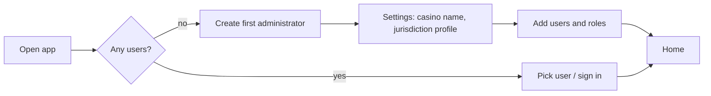
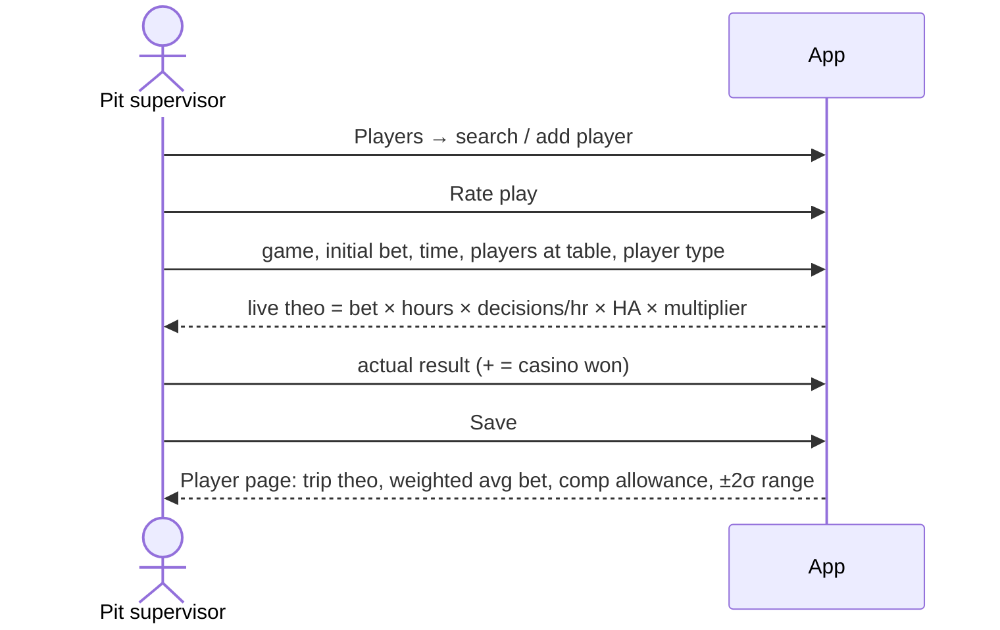
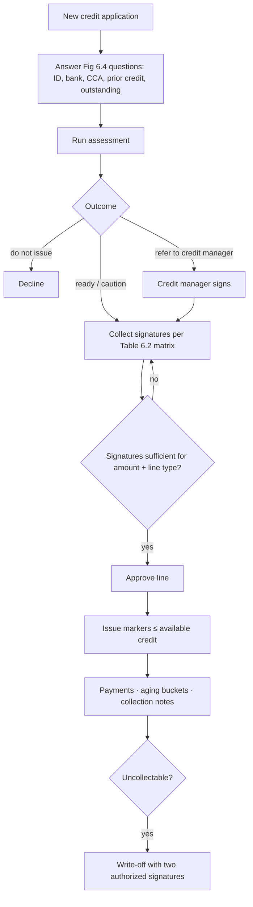
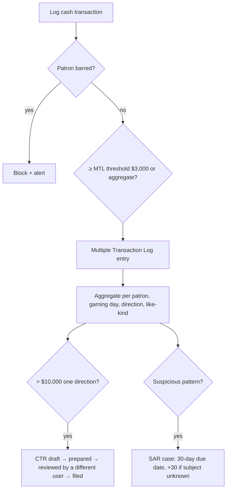
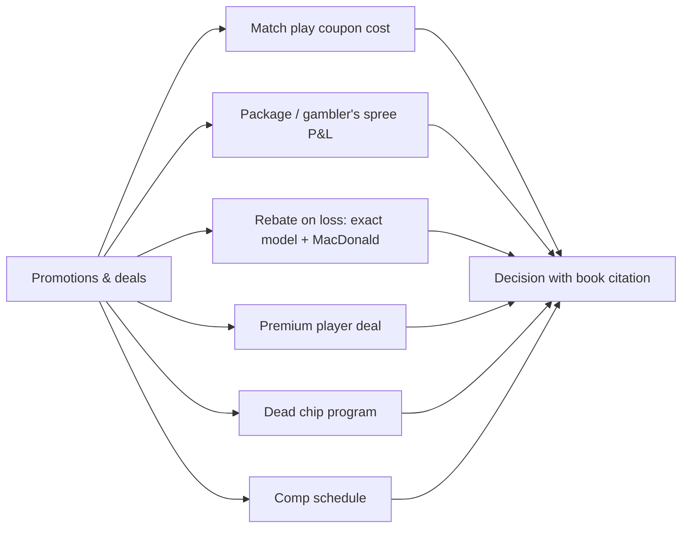

# 02 · User journeys

Each journey names the role (see `03_architecture.md` → Roles), the screens it touches and the book pages it implements. Diagrams are Mermaid; GitHub and most IDEs render them.

## J1 · First run (administrator)



Local mode keeps everything on the device. Cloud mode signs in with Firebase email/password; roles are assigned by the `setUserRole` function, never by the client.

## J2 · Rate a player's session (pit supervisor) — Ch 12 pp.221–225, Ch 19 pp.357–376



Rules taken from the book: record the **initial** bet (not doubles/splits, p.225); decisions per hour drop as players join (Table 13.1); comps use theoretical, not actual, loss (p.220).

## J3 · Close a table shift and investigate hold (pit/cage) — Ch 9–10, Ch 13

```mermaid
flowchart TD
  A[Record shift: opener, fills, credits, closer, drop] --> B[Win = drop − (opener + fills − credits − closer)]
  B --> C[Hold % = win ÷ drop]
  C --> D{Outside base hold ± tolerance?}
  D -- no --> E[Dashboard: OK]
  D -- yes --> F[Flag table]
  F --> G[Hold tools: diagnostics checklist]
  G --> H[Remove documented hits from hold]
  H --> I[Statistical hold, incl. markers repaid with cheques]
```

## J4 · Issue credit (credit executive, casino manager) — Ch 6 pp.91–110, Fig 6.4



## J5 · Cash transaction compliance (cage, compliance officer) — Ch 5 pp.61–82



Cash-in and cash-out are never netted against each other (p.66). The gaming-day cutoff and thresholds live in the jurisdiction profile, so a property outside Nevada edits them in Settings instead of code.

## J6 · Evaluate a promotion or deal (marketing, casino manager) — Ch 14–16



## J7 · Staff the pit (casino manager) — Ch 4 pp.51–59, Ch 13

Enter tables opened per day and shift → dealers per shift (×80/60 relief), weekly heads (÷5 × 52/50 vacation), floorpersons (1 per N tables, rounded up per shift) → payroll → table-opening break-even by occupancy (Table 13.2).

## J8 · Look something up (anyone) — all chapters

Library: chapter notes with page references, plus a 168-term glossary. Every calculation screen carries "Book · Ch x p.y" chips that point to the same source.
