# 03 · Architecture

## Overview

```mermaid
flowchart TB
  subgraph Client["Flutter app (web · Android · iOS)"]
    UI[Feature pages<br/>players · tables · credit · compliance · evaluate · staffing · library · settings]
    P[Riverpod providers<br/>StreamProvider per collection, Provider.family selectors]
    R[Repository&lt;T&gt;<br/>returns Either&lt;Failure,T&gt;]
    S{{RecordStore port}}
    L[LocalRecordStore<br/>shared_preferences]
    F[FirestoreRecordStore<br/>casinos/&#123;casinoId&#125;/…]
    E[[casino_engine<br/>pure Dart, book formulas + citations]]
    UI --> P --> R --> S
    S --> L
    S --> F
    UI --> E
    P --> E
  end
  subgraph Firebase["Firebase (cloud mode)"]
    A[Auth: email/password]
    FS[(Firestore + security rules)]
    CF[Cloud Functions<br/>roles · credit · markers · CTR]
    H[Hosting: web build]
  end
  F <--> FS
  Client -- sign in --> A
  Client -- privileged actions --> CF --> FS
```



### Two packages

| Package | What | Depends on |
|---|---|---|
| `packages/casino_engine` | Every calculation in the book as pure functions: rating/theo, comps, table win & hold, statistical drop, gaming tax, staffing, credit flow (Fig 6.4) & signature matrix (Table 6.2), AML aggregation (Reg 6A / Title 31), slots, game math (baccarat, craps, roulette, keno, blackjack rules), promotions, rebates (exact model + MacDonald), premium deals, sports & race book. Each result carries `BookRef` citations. | `dart:math` only |
| `app` | Flutter UI, persistence, roles, workflows (approve, sign, file, write off). | `casino_engine`, Riverpod 3, go_router, dartz, Firebase |

Keeping the maths outside Flutter means it is tested with `dart test` in milliseconds, can be reused by a backend (Cloud Functions in Dart, a reporting job), and cannot be broken by UI work.

### Layers inside the app

The app follows the team's `flutter-riverpod-firebase-architecture` skill throughout.

```
lib/
  main.dart                     # maps --flavor (or FLAVOR define on web) to F.appFlavor
  flavors.dart                  # Flavor { dev, prod }, backend choice, CASINO_ID
  bootstrap.dart                # bindings → orientation → Firebase → App Check → prefs →
                                # ProviderContainer → Crashlytics → eager providers → runApp
  firebase_options_dev.dart / firebase_options_prod.dart   # flutterfire configure per project
  app/
    app.dart                    # MaterialApp.router
    session_cleanup.dart        # reacts to signed-in → signed-out
    local_backend.dart          # registry of local action handlers
  core/
    error/      failure.dart, exceptions.dart, failure_mapper.dart
    typedefs/   ResultFuture, ResultVoid, Json
    storage/    record_store.dart (port), local_record_store.dart, firestore_record_store.dart, prefs_service.dart
    backend/    functions_gateway.dart (Firebase callables | local handlers)
    session/    before_sign_out_hooks.dart
    routing/    app_router.dart, route_names.dart, shell_scaffold.dart
    theme/  widgets/  util/
  shared/providers/  prefs_provider.dart, firebase_providers.dart, backend_providers.dart
  features/<feature>/
    data/datasources/   <feature>_remote_datasource.dart  (+ <feature>_local_actions.dart)
    data/models/        freezed + json_serializable, fromEntity / toEntity
    data/repositories/  <feature>_repository_impl.dart — try/catch → Either<Failure, T>
    domain/entities/    freezed, no JSON
    domain/repositories/ abstract interface
    presentation/providers/ <feature>_providers.dart, _state.dart, _notifier.dart (StateNotifier)
    presentation/pages/ presentation/widgets/
```

Features with data: auth, settings, players, tables, credit, compliance. Calculator-only features (home, evaluate, staffing, library) have just `presentation/pages`, as the skill allows for small read-only features.

**Rules applied in every feature**

- Datasources throw; repositories return `Either<Failure, T>` (streams map errors to `Failure` too). Widgets only show `Failure.displayMessage`.
- Models know JSON; entities don't. Enums carry wire values with a safe `fromWire` fallback (unknown role → auditor, unknown status → open/draft). Wire strings are the same as before the refactor, so existing data still reads.
- Reads are `StreamProvider`s keyed on the current user; they return an empty list when signed out, so rules never reject a guest. SAR cases return empty for roles that may not read them. Per-item selectors (`playerByIdProvider`, `availableCreditProvider`…) derive from one stream.
- Mutations go through a `StateNotifier` per feature with a freezed state (`saving`, `failure`). Notifiers check rules first for instant feedback; the server checks again.
- **Self-registration (Firebase):** anyone can create an email/password account, but that only files an `access_requests/{uid}` document. Until an administrator assigns a role (`setUserRole`, which also deletes the request) the account sees nothing but the waiting screen — every data provider is keyed on a profile in `users`.
- **The client never writes privileged state.** Roles, credit signatures and decisions, marker issue/payments/write-offs and CTR sign-offs are named actions (`setUserRole`, `signCreditApplication`, `decideCreditApplication`, `issueMarker`, `recordMarkerPayment`, `signMarkerWriteOff`, `writeOffMarker`, `advanceCtr`). On Firebase they are Cloud Functions; on the local backend, Dart handlers with the same checks and messages. Firestore rules allow the client only drafts and a few named fields.

**Remaining deviations from the skill**

| Skill says | This app does | Why |
|---|---|---|
| Guest mode: browse without an account | Every route except sign-in requires an operator | Internal staff tool; nothing is public. `_requiresAuth` is still the single switch. |
| Datasource talks to Firestore directly | Datasources use the `RecordStore` port + `FunctionsGateway` | Keeps a no-backend dev mode for demos, training and tests; Firestore is one implementation. |
| Every string in ARB (`flutter-l10n-a11y`) | English strings in code | Not done in this pass; next step (Vietnamese). |
| Messaging, Remote Config, Storage | Not added | No feature needs them yet. |
| `package:flutter/material.dart` | unchanged | Deprecated in Flutter 3.50 in favour of `material_ui`; infos only. |

### Flavors and backends

| | dev | prod |
|---|---|---|
| Run | `flutter run --flavor dev` | `flutter run --flavor prod` |
| Web | `--dart-define=FLAVOR=dev` | `--dart-define=FLAVOR=prod` |
| Backend | Local (device storage) unless `--dart-define=USE_FIREBASE=true` | Always Firebase |
| Firebase project | **CMS4Cas-Dev** (`firebase_options_dev.dart`) | **CMS4Cas** (`firebase_options_prod.dart`) |
| Region | `asia-southeast1` | `asia-southeast1` |
| App id (Android package / iOS bundle) | `store.cms4cas.app.dev` | `store.cms4cas.app` |
| App name | CMS Dev | CMS |
| App Check | Debug providers | Play Integrity / App Attest; web needs `APPCHECK_WEB_KEY` |
| Crashlytics | collection off | on (not on web) |

Firebase options are Dart-side (`firebase_options_<flavor>.dart`). Service files are per flavor — `android/app/src/<flavor>/google-services.json`, and `ios/config/<flavor>/GoogleService-Info.plist` attached only to that flavor's build configurations — so a dev build cannot reach production. (The skill prefers no iOS plist at all; FlutterFire's per-configuration plist keeps the same guarantee and gives Crashlytics its symbol-upload config.) Android product flavors are in `android/app/flavorizr.gradle.kts`; iOS has `dev`/`prod` schemes and `Debug|Release|Profile-<flavor>` configurations with `ios/Flutter/<flavor><Config>.xcconfig`.

### Session hygiene

- `BeforeSignOutHooks`: run while still signed in, time-boxed (Firebase: flush pending writes).
- `sessionCleanupProvider`: on signed-in → signed-out, drops the profile; data providers re-key to empty. Firestore disk persistence is **off**, so no patron data stays on a shared device.

### Data flow and error handling

- `RecordStore.watch(collection)` → datasource maps to models → repository maps to entities and `Failure`s → `StreamProvider` → page. Every screen updates live, across devices on Firebase.
- Corrupt local data surfaces as a readable error, not a blank screen (tested).

### Persistence modes

| | Local (dev default) | Firebase |
|---|---|---|
| Storage | `shared_preferences` (browser localStorage on web), one key per collection | Firestore `casinos/{casinoId}/{collection}/{id}` |
| Sign-in | pick an operator (no password) | Firebase Auth email/password |
| Privileged actions | Dart handlers (`*_local_actions.dart`) | Cloud Functions (`firebase/functions/src/index.js`) |
| Use for | demo, training, tests | production / multi-user |

Local mode has **no authentication** — anyone with the device can pick any user. It is for evaluation and training, not live operations.

## Roles and permissions

| Role (`wire`) | Rate players | Manage players | Table accounting | Credit apply | Credit assess | Credit approve/sign | Markers | Cash tx | Compliance review | Evaluate deals | Staffing |
|---|---|---|---|---|---|---|---|---|---|---|---|
| Admin (`admin`) | ✓ | ✓ | ✓ | ✓ | ✓ | ✓ | ✓ | ✓ | ✓ | ✓ | ✓ |
| Casino manager (`casino_manager`) | ✓ | ✓ | ✓ | ✓ | ✓ | ✓ | ✓ | | ✓ | ✓ | ✓ |
| Pit supervisor (`pit_supervisor`) | ✓ | ✓ | ✓ | | | | ✓ | ✓ | | | |
| Cage cashier (`cage_cashier`) | | ✓ | | ✓ | | | ✓ | ✓ | | | |
| Credit executive (`credit_executive`) | | ✓ | | ✓ | ✓ | ✓ | ✓ | | | | |
| Compliance officer (`compliance_officer`) | | | | | | | | ✓ | ✓ | | |
| Marketing / host (`marketing`) | ✓ | ✓ | | ✓ | | ✓ | | | | ✓ | |
| Auditor (`auditor`) | read-only everywhere | | | | | | | | | | |

Credit signatures additionally need a **credit role** on the user — President/GM, VP Finance, Casino Manager, Credit Manager (credit committee), Shift Manager, Host, Director of Casino Cage (Table 6.2 p.103). Whether a set of signatures is enough for an amount and line type is decided by `Credit.checkSignatures`.

Separation of duties enforced in the app:
- A CTR must be reviewed by a different user from the one who prepared it.
- A write-off needs two different authorized signers.
- A referred credit application needs the credit manager's signature before approval.
- Cash transactions are append-only (Firestore rules deny update/delete).
- Each of these is enforced by the server action, not only by the UI.

The UI hides actions a role cannot perform; Firestore rules enforce the same in cloud mode, so a modified client cannot bypass them.

## Security

- Firestore rules: membership via `casinos/{cid}/users/{uid}`; per-collection role lists; `users` writable only by Admin SDK; SAR cases readable only by admin/compliance/casino manager/auditor.
- `setUserRole` callable: caller must be an admin of that casino, except the very first user of an empty casino (bootstrap); validates role and credit role values; looks up accounts by email; removes the registrant's access request in the same batch.
- `access_requests/{uid}`: a signed-in account may write only its own request, only the fields `id, uid, name, email, requestedAt`, and the email must equal its Auth token's email. Only admins can read others' requests or delete them.
- Credit, marker and CTR callables re-apply Table 6.2, the available-credit cap, the two-signer write-off rule and reviewer ≠ preparer inside transactions, and stamp the signer from the server-side profile — a modified client cannot forge a signature or an approval.
- App Check is activated in prod; Firestore disk persistence is off.
- No secrets in the client. `firebase_options.dart` is generated by `flutterfire configure` and contains only public identifiers.
- Personal data (ID numbers, addresses) is stored as entered; use cloud mode with Firestore's encryption at rest for real patron data. Do not use local mode for real patron data on shared devices.

## Configuration instead of code

`Settings` (stored as `settings/main`) holds: casino name, jurisdiction label, AML profile (MTL threshold, CTR threshold, gaming-day start hour, SAR days, aggregation regime), comp policy (% of theo, % of loss), gaming tax rate, hold tolerance, per-game house advantage and multipliers, rating hit threshold. "Reset to book defaults" restores the Nevada-2003 values from the book. This is how a Vietnamese or other jurisdiction is supported without code changes; the figures must be checked against the local regulation by the operator.
