# 03 · Architecture

## Overview

```mermaid
flowchart TB
  subgraph Client["Flutter app (web · Android · iOS)"]
    UI[Feature pages<br/>players · tables · credit · compliance · evaluate · staffing · library · settings]
    P[Riverpod providers<br/>StreamProvider per collection, Provider.family selectors]
    R[Repository&lt;T&gt;<br/>returns Either&lt;Failure,T&gt;]
    S{{RecordStore port}}
    L[LocalRecordStore<br/>shared_preferences]
    F[FirestoreRecordStore<br/>casinos/&#123;casinoId&#125;/…]
    E[[casino_engine<br/>pure Dart, book formulas + citations]]
    UI --> P --> R --> S
    S --> L
    S --> F
    UI --> E
    P --> E
  end
  subgraph Firebase["Firebase (cloud mode)"]
    A[Auth: email/password]
    FS[(Firestore + security rules)]
    CF[Cloud Function setUserRole]
    H[Hosting: web build]
  end
  F <--> FS
  Client -- sign in --> A
  Client -- assign roles --> CF --> FS
```



### Two packages

| Package | What | Depends on |
|---|---|---|
| `packages/casino_engine` | Every calculation in the book as pure functions: rating/theo, comps, table win & hold, statistical drop, gaming tax, staffing, credit flow (Fig 6.4) & signature matrix (Table 6.2), AML aggregation (Reg 6A / Title 31), slots, game math (baccarat, craps, roulette, keno, blackjack rules), promotions, rebates (exact model + MacDonald), premium deals, sports & race book. Each result carries `BookRef` citations. | `dart:math` only |
| `app` | Flutter UI, persistence, roles, workflows (approve, sign, file, write off). | `casino_engine`, Riverpod 3, go_router, dartz, Firebase |

Keeping the maths outside Flutter means it is tested with `dart test` in milliseconds, can be reused by a backend (Cloud Functions in Dart, a reporting job), and cannot be broken by UI work.

### Layers inside the app

Feature-first, following the team's `flutter-riverpod-firebase-architecture` conventions:

```
lib/
  main.dart → bootstrap.dart          # init prefs or Firebase, choose RecordStore, ProviderScope
  app_config.dart                     # USE_FIREBASE, CASINO_ID dart-defines
  app/app.dart                        # MaterialApp.router
  core/
    data/   record_store.dart, local_record_store.dart, firestore_record_store.dart, repository.dart
    error/  failure.dart (Failure + mapToFailure)
    auth/   roles.dart (AppRole, Perm), session.dart
    routing/ app_router.dart (redirect to /sign-in), shell_scaffold.dart (rail ≥1000 px, drawer below)
    widgets/ shared form/metric/citation widgets
  features/<feature>/data/…models + providers
  features/<feature>/presentation/…pages
```

**Deviations from the house template, on purpose**

| Template says | This app does | Why |
|---|---|---|
| freezed + json_serializable models | Hand-written immutable classes with `toJson`/`fromJson` | No build_runner step for a first release; models are small. Migrating to freezed later is mechanical. |
| Per-feature datasource + repository impl | One generic `Repository<T>` over a `RecordStore` port | All features store flat documents in one collection each; the port is what lets the same code run fully offline (local) or on Firestore. |
| Flavors dev/prod | `--dart-define=USE_FIREBASE`, `CASINO_ID` | v1 has one Firebase project; add flavorizr when a second environment exists. |
| `package:flutter/material.dart` | unchanged | Flutter 3.50 marks it deprecated in favour of `material_ui`; analyzer shows infos only. Migrate together with the next Flutter upgrade. |

### Data flow and error handling

- `RecordStore.watch(collection)` → `Stream<List<Json>>`; `Repository<T>.watch()` maps to models; pages use `StreamProvider`s, so every screen updates live, including across devices in cloud mode.
- Writes go through `Repository.save/remove`, which return `Either<Failure, T>`; pages show `Failure.message` in a snackbar. No raw exception text reaches users.
- Corrupt local data surfaces as a readable error state, not a blank screen (tested).

### Persistence modes

| | Local (default) | Cloud |
|---|---|---|
| Start | `flutter run` | `flutter run --dart-define=USE_FIREBASE=true --dart-define=CASINO_ID=<id>` |
| Storage | `shared_preferences` (browser localStorage on web), one key per collection | Firestore `casinos/{casinoId}/{collection}/{id}` |
| Sign-in | pick a local user (no password) | Firebase Auth email/password |
| Roles | stored locally, editable by admin | written only by `setUserRole` Cloud Function; rules forbid client writes |
| Use for | demo, training, single-device trial, offline evaluation | production / multi-user |

Local mode has **no authentication** — anyone with the device can pick any user. It is for evaluation and training, not for live operations.

## Roles and permissions

| Role (`wire`) | Rate players | Manage players | Table accounting | Credit apply | Credit assess | Credit approve/sign | Markers | Cash tx | Compliance review | Evaluate deals | Staffing |
|---|---|---|---|---|---|---|---|---|---|---|---|
| Admin (`admin`) | ✓ | ✓ | ✓ | ✓ | ✓ | ✓ | ✓ | ✓ | ✓ | ✓ | ✓ |
| Casino manager (`casino_manager`) | ✓ | ✓ | ✓ | ✓ | ✓ | ✓ | ✓ | | ✓ | ✓ | ✓ |
| Pit supervisor (`pit_supervisor`) | ✓ | ✓ | ✓ | | | | ✓ | ✓ | | | |
| Cage cashier (`cage_cashier`) | | ✓ | | ✓ | | | ✓ | ✓ | | | |
| Credit executive (`credit_executive`) | | ✓ | | ✓ | ✓ | ✓ | ✓ | | | | |
| Compliance officer (`compliance_officer`) | | | | | | | | ✓ | ✓ | | |
| Marketing / host (`marketing`) | ✓ | ✓ | | ✓ | | ✓ | | | | ✓ | |
| Auditor (`auditor`) | read-only everywhere | | | | | | | | | | |

Credit signatures additionally need a **credit role** on the user — President/GM, VP Finance, Casino Manager, Credit Manager (credit committee), Shift Manager, Host, Director of Casino Cage (Table 6.2 p.103). Whether a set of signatures is enough for an amount and line type is decided by `Credit.checkSignatures`.

Separation of duties enforced in the app:
- A CTR must be reviewed by a different user from the one who prepared it.
- A write-off needs two different authorized signers.
- A referred credit application needs the credit manager's signature before approval.
- Cash transactions are append-only (Firestore rules deny update/delete).

The UI hides actions a role cannot perform; Firestore rules enforce the same in cloud mode, so a modified client cannot bypass them.

## Security

- Firestore rules: membership via `casinos/{cid}/users/{uid}`; per-collection role lists; `users` writable only by Admin SDK; SAR cases readable only by admin/compliance/casino manager/auditor.
- `setUserRole` callable: caller must be an admin of that casino, except the very first user of an empty casino (bootstrap); validates role and credit role values; looks up accounts by email.
- No secrets in the client. `firebase_options.dart` is generated by `flutterfire configure` and contains only public identifiers.
- Personal data (ID numbers, addresses) is stored as entered; use cloud mode with Firestore's encryption at rest for real patron data. Do not use local mode for real patron data on shared devices.

## Configuration instead of code

`Settings` (stored as `settings/main`) holds: casino name, jurisdiction label, AML profile (MTL threshold, CTR threshold, gaming-day start hour, SAR days, aggregation regime), comp policy (% of theo, % of loss), gaming tax rate, hold tolerance, per-game house advantage and multipliers, rating hit threshold. "Reset to book defaults" restores the Nevada-2003 values from the book. This is how a Vietnamese or other jurisdiction is supported without code changes; the figures must be checked against the local regulation by the operator.
