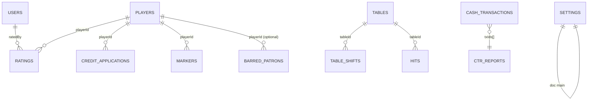

# 04 · Data model

One flat collection per entity. In cloud mode the path is `casinos/{casinoId}/{collection}/{id}`; in local mode each collection is one `shared_preferences` key `cms.<collection>` holding `{id: json}`. Dates are ISO-8601 strings; money is a number in the property's currency.

## Collections

| Collection | Fields | Notes / book source |
|---|---|---|
| `users` | name, role, creditRole?, email? | Cloud: written only by `setUserRole`. |
| `settings` (`main`) | casinoName, jurisdictionLabel, aml{regime, ctrThreshold, mtlThreshold, cashForCashLimit, casinoCheckForCashLimit, sarThreshold, sarFileDays, sarExtensionDays, gamingDayStartHour, nearThresholdPct}, comps{pctOfTheo, quickLossPctOfActual, quickLossEnabled}, gamingTaxRate, holdTolerance, houseAdvantage{gameId: %}, multipliers{gameId: {type: x}}, ratingHitThreshold | Defaults = book (Nevada 2003). |
| `players` | name, playerNo, idDocument, address, notes, createdBy, createdAt | |
| `ratings` | playerId, gameId, gameName, table, ratedBy, averageBet, minutes, decisionsPerHour, effectiveAdvantage, theo, actualCasinoWin, sd, players, type, at | Theo and SD stored as computed at the time, so later setting changes do not rewrite history. Ch 12, Ch 19. |
| `tables` | name, gameId, pit, minBet, maxBet, baseHold, system (marker / name-credit) | Ch 9–10, Ch 13. |
| `table_shifts` | tableId, shift, gamingDay, recordedBy, recordedAt, openingInventory, fills, credits, closingInventory, currencyInBox, chequesInBox, markersIssued, markersRedeemedInPitCash, markersRedeemedInPitCheques, system (+ computed drop, win, hold, statisticalDrop) | Win = drop − (opener + fills − credits − closer). Append-only for non-admins. |
| `hits` | tableId, playerLabel, gamingDay, playerDrop, casinoResult, note, recordedBy | Documented large results removed from "hold excl. hits". |
| `credit_applications` | playerId, createdBy, lineType, amount, status, disposition, answers{Fig 6.4}, outcome, referrals[], signatures[{userId, userName, role, at}], createdAt, decidedAt?, declineReason? | Ch 6, Fig 6.4, Table 6.2. |
| `markers` | playerId, number, table, issuedBy, amount, issuedAt, payments[{amount, method, recordedBy, at}], status, writeOffAmount?, writeOffReason?, writeOffSignatures[], collectionNote | Balance and age derived; aging buckets 0–30/31–60/61–90/90+. |
| `cash_transactions` | patronKey, patronLabel, area, recordedBy, type (wire value carries direction and like-kind group), amount, at, visitId? | Append-only. Gaming day derived from `at` and the profile's cutoff. Ch 5. |
| `ctr_reports` | patronKey, patronLabel, aggregateLabel, direction, gamingDay, total, txIds[], fields{required CTR fields}, status (draft/prepared/reviewed/filed), preparedBy(+Id), reviewedBy(+Id), filedAt? | Reviewer ≠ preparer. |
| `barred_patrons` | description, reason, playerId?, addedBy, since, active | Checked on every cash entry. |
| `sar_cases` | subject, summary, openedBy, amount, detectedAt, extended, filedAt? | Due = detected + 30 days (+30 if extended). Restricted read. |

## Who writes what

| Collection | Client may write | Only via action (Cloud Function / local handler) |
|---|---|---|
| `users` | — | everything (`setUserRole`) |
| `credit_applications` | create as draft; `answers`, `outcome`, `referrals`, `status` draft → pending while draft | signatures, approve, decline |
| `markers` | `collectionNote` | issue, payments, write-off signatures, write-off |
| `ctr_reports` | create as draft; `fields` while draft | prepared, reviewed, filed |
| `cash_transactions` | create (append-only) | — |

## Indexes

All queries are whole-collection streams filtered client-side, so no composite indexes are needed for v1. When a property grows past a few thousand records per collection, add server-side filters (by `gamingDay`, `playerId`) and the matching indexes; the `RecordStore` port is the single place to change.

## Retention

The book requires records such as MTLs and CTR copies to be kept for set periods (Ch 5). The app never deletes cash transactions; set Firestore backups/export schedules to meet the local retention period.
